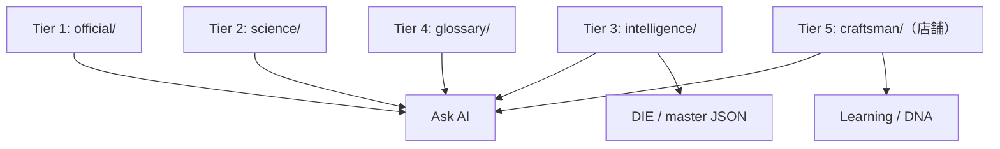

# Pizza-Lab Knowledge Database 設計

> Pizza-Lab を「計算アプリ」から「世界中のピッツァ職人の知識 OS」へ育てるための Knowledge Database 全体設計。  
> 正本: `PIZZALAB_MASTER.md` / スキーマ: `docs/schemas/knowledge-entry.schema.json`

**Version:** 0.1.0  
**Last Updated:** 2026-07-06

---

## 1. 目的

Pizza-Lab Knowledge Database（KDB）は以下を実現する。

| 目的 | 内容 |
|------|------|
| **知識の蓄積** | 公式・科学・Intelligence・職人知識を体系化 |
| **AI の根拠** | Ask AI が出典・Tier を区別して回答 |
| **DIE の補助** | 数値計算は DIE。KDB は説明・ルール表・参照 |
| **店舗資産** | craftsman / Learning は shop スコープ |
| **その店の100点** | DNA・職人評価を店舗ごとに保持 |

---

## 2. 設計思想

1. **公式知識を最上位（Tier 1）** — STG / VPN / APN を尊重。全文転載せず要約・出典・実践知
2. **STG だけを唯一の正解にしない** — 地域文化・職人の理想を同等に尊重
3. **知識と計算を分離** — KDB は説明。数値は DIE + master JSON
4. **AI は Tier を明示** — 公式 / 科学 / 店舗学習を混同しない
5. **Learning は店舗資産** — craftsman カテゴリは shopId 必須、他店参照禁止
6. **拡張可能** — 分類・言語・メディア（写真）を将来追加

---

## 3. 知識階層（Tier）



| Tier | 分類 | スコープ | AI 表示 |
|------|------|----------|---------|
| 1 | `official/` | グローバル | 「公式（STG/VPN/APN）要約」 |
| 2 | `science/` | グローバル | 「科学知識」 |
| 3 | `intelligence/` | グローバル | 「Pizza-Lab Intelligence」 |
| 4 | `glossary/` | グローバル | 用語定義 |
| 5 | `craftsman/` | **shopId** | 「あなたの店の記録」 |

**優先順位（RAG）:** Tier 1 → 2 → 3 → 5（自店のみ）→ 4

---

## 4. 分類体系

### 4.1 official/ — 公式技術体系

```
content/knowledge/official/
├── stg/          STG（真のナポリピッツァ）
├── vpn/          Verace Pizza Napoletana
└── apn/          Associazione Pizzaiuoli Napoletani
```

- 規約 **全文転載禁止**
- 各記事: 要約 + 出典 URL + 改定日 + 実践知 + パラメータ参照表

### 4.2 science/ — 科学知識

```
content/knowledge/science/
├── gluten/       グルテン
├── fermentation/ 発酵
├── yeast/        酵母
├── starch/       デンプン
├── enzyme/       酵素
├── temperature/  温度
└── water/        水
```

### 4.3 intelligence/ — Pizza-Lab Intelligence 体系

```
content/knowledge/intelligence/
├── dough-intelligence/   DIE
├── flour-intelligence/   粉 Personality
├── mixer-intelligence/   ミキサー
├── method-intelligence/  製法・Preferment
├── dough-dna/            DNA
└── learning-engine/      Learning
```

`.cursor/rules/` の各 Intelligence Rule と1対1対応。

### 4.4 craftsman/ — 職人・店舗知識（Tier 5）

```
craftsman/{shopId}/
├── runs/           店舗実測（DoughRun）
├── notes/          職人メモ
├── photos/         写真記録（将来）
├── self-eval/      自己評価（DNA スコア入力）
└── shop-100/       その店の100点定義
```

**DB 保存**（Markdown ソース + 構造化 JSON）。v0.1 は Run のみ。

### 4.5 glossary/ — 用語集

```
content/knowledge/glossary/
├── terms.json      構造化用語（schema 参照）
└── articles/       長文解説 Markdown
```

多言語: `ja` / `en` / `it` 必須フィールド。

---

## 5. ストレージ構成

| レイヤー | 場所 | 内容 |
|----------|------|------|
| **ソース** | `content/knowledge/` | 人間編集 Markdown + Frontmatter |
| **構造化** | `data/*-master.json` | DIE 初期値（mixer, flour, method） |
| **スキーマ** | `docs/schemas/` | knowledge-entry, dna, profile, die-input |
| **店舗** | DB（将来） | craftsman, Learning, DNA |
| **検索** | `lib/knowledge/` | v0.1 キーワード / v0.2+ Vector |

```
content/knowledge/     ← Git 管理・レビュー可能
data/*.json            ← master 初期値（設計: *.design.md）
DB craftsman/*         ← shopId 隔離
```

---

## 6. Knowledge Entry 共通フォーマット

すべての記事は `knowledge-entry.schema.json` に準拠。

```yaml
---
id: official-vpn-ddt-summary
tier: official
category: official/vpn
title: VPN における生地温度の考え方
languages: [ja, en]
sources:
  - name: VPN Disciplinare
    url: https://...
    accessedAt: 2026-01-01
summaryType: practice  # summary | practice | parameter | glossary
tags: [ddt, temperature, napoli]
relatedIntelligence: [dough-intelligence, method-intelligence]
aiUsable: true
shopId: null           # craftsman のみ必須
---
```

本文: 300〜2000 字。パラメータ表は YAML または Markdown 表。

---

## 7. AI（Ask）との連携

### 7.1 RAG コンテキスト構築

```
ユーザー質問
  → Tier フィルタ（Quick: Tier 1-3 のみ / Lab: + 自店 Tier 5）
  → キーワード検索（v0.1）
  → 上位 2 件 × 500 字以内
  → LLM（tier ラベル付き system prompt）
  → 回答 + 出典リンク + tier バッジ
```

### 7.2 System Prompt 原則

- Tier 1（公式）と Tier 5（店舗）を **混同しない**
- 「VPN では〜」と「あなたの店では Run 12 で〜」を区別
- 数値提案は **DIE 結果を参照**。KDB から数値を invent しない
- STG を唯一正解として提示しない

### 7.3 tier バッジ（UI）

| バッジ | 意味 |
|--------|------|
| 公式 | official/ |
| 科学 | science/ |
| 体系 | intelligence/ |
| 用語 | glossary/ |
| あなたの店 | craftsman/ |

---

## 8. DIE / master JSON との関係

| データ | 役割 | 計算 |
|--------|------|------|
| KDB Markdown | 説明・背景・実践知 | なし |
| master JSON | DIE 初期値・Personality スコア | DIE |
| craftsman Run | Learning 入力 | Learning → DIE 補正 |
| DNA schema | 目標食感 | DNA → DIE 逆算 |

**KDB 記事に配合数値を書いても、DIE の計算根拠にはしない**（参照・ルール表としてのみ）。

---

## 9. 初期コンテンツ計画（v0.1）

| 分類 | 目標本数 | 優先 |
|------|----------|------|
| intelligence/dough-intelligence | 5 | P0 |
| intelligence/mixer-intelligence | 3 | P0 |
| science/temperature | 2 | P1 |
| official/stg | 2（要約） | P1 |
| glossary | 20 語 | P1 |
| craftsman | 0（実装後） | P2 |

---

## 10. セキュリティ・プライバシー

- `craftsman/*` は **shopId 認証必須**
- 店舗間 Knowledge 共有は **明示オプトイン**（将来コミュニティ）
- 写真・メモは店舗削除権あり
- 匿名化 Learning をグローバル master 更新に使う場合は ADR 必須

---

## 11. 関連ドキュメント

| ファイル | 内容 |
|----------|------|
| `docs/schemas/knowledge-entry.schema.json` | 記事共通スキーマ |
| `docs/schemas/dna.schema.json` | Dough DNA |
| `data/mixer-master.design.md` | ミキサー master |
| `data/flour-master.design.md` | 粉 master |
| `data/method-presets.design.md` | 製法 preset |
| `.cursor/rules/method-intelligence.mdc` | 公式製法 |
| `.cursor/rules/flour-intelligence.mdc` | 粉 Personality |

---

## 変更履歴

| Version | Date | 変更 |
|---------|------|------|
| 0.1.0 | 2026-07-06 | 初版 |
