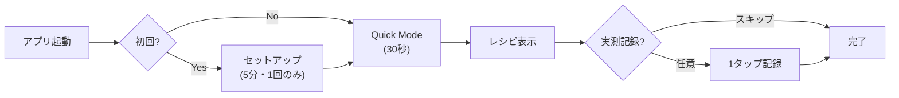

# Quick Mode フロー設計

> スマホファースト・30秒以内・片手操作を前提とした Quick Mode（営業モード）の UI/UX 設計。  
> 仕様正本: [PIZZALAB_MASTER.md](../PIZZALAB_MASTER.md)  
> プロファイルスキーマ: [schemas/profile.schema.json](./schemas/profile.schema.json)

---

## 1. 設計原則

| 原則 | 内容 |
|------|------|
| **30秒以内** | 起動からレシピ表示まで30秒。計測対象。 |
| **片手操作** | 親指で届く範囲に主要操作を配置。 |
| **2〜4入力** | 毎日の入力は最小限。それ以上は Lab Mode へ誘導。 |
| **迷わない** | 1画面1目的。確認ダイアログは実測記録のみ。 |
| **プロファイル優先** | 初回設定済みの値で自動補完。毎日触らせない。 |
| **「わからない」OK** | 未入力は推定値で補完。エラーにしない。 |

---

## 2. ユーザージャーニー概要



---

## 3. 初回セットアップ（1回のみ・約5分）

### 3.1 方針

- **3ステップ・最大7項目**。詳細は後から設定画面で変更可。
- 各ステップに「わからない」選択肢を常設。
- 完了後は Quick Mode に直行。

### 3.2 ステップ構成

#### Step 1: 店舗（30秒）

| 項目 | 必須 | 入力方法 |
|------|------|----------|
| 店舗名 | ✅ | テキスト |
| 所在地（都市） | 任意 | テキスト or 位置情報 |

→ 外気温自動取得のため、所在地は推奨だが未入力可。

#### Step 2: 生地の基本（2分）

| 項目 | 必須 | 入力方法 |
|------|------|----------|
| 製法 | ✅ | カード選択（ナポリ / NY / ローマ） |
| 主力粉 | ✅ | リスト選択（flour-master） |
| 加水率 | 自動 | 製法プリセットから自動設定。変更可。 |
| 1枚重量 (g) | ✅ | 数値 or スライダー（200〜280） |
| 1日の平均枚数 | ✅ | 数値（Quick デフォルト値に使用） |

#### Step 3: ミキサーと温度（2分）

| 項目 | 必須 | 入力方法 |
|------|------|----------|
| ミキサー種別 | ✅ | カード選択 + **「わからない」** |
| ミキサー機種 | 任意 | リスト + **「わからない」** |
| 目標生地温 (DDT) | ✅ | プリセット選択（ナポリ: 24°C 等） |

→ 機種・回転数・時間は **聞かない**。種別平均で補完。

#### 完了画面

```
✓ セットアップ完了
  「平日営業」プロファイルが作成されました。

  [ 今日のレシピを出す ]  ← Quick Mode へ
```

---

## 4. Quick Mode 毎日フロー（30秒）

### 4.1 画面遷移

```
/quick          入力画面（1画面完結）
  ↓ 自動計算（即時）
/quick/result   レシピ結果
  ↓ 任意
/quick/record   実測記録（ボトムシート）
```

**原則: 入力 → 結果は1タップ以内。ページ遷移は最大2回。**

### 4.2 入力画面 `/quick`

#### レイアウト（スマホ・縦持ち）

```
┌─────────────────────────┐
│  Pizza-Lab    [⚙設定]  │  ← ヘッダー（固定・最小）
├─────────────────────────┤
│                         │
│  今日のプロファイル      │
│  ┌──────┐ ┌──────┐     │
│  │平日  │ │大会  │     │  ← 横スクロールカード
│  │営業 ✓│ │     │     │     デフォルト選択済み
│  └──────┘ └──────┘     │
│                         │
│  作る枚数               │
│  ┌─────────────────┐   │
│  │  ［ − ］ 40 ［ + ］│   │  ← 大きな +/- ボタン
│  └─────────────────┘   │     片手親指操作
│  前回: 40枚             │  ← 前回値をデフォルト表示
│                         │
│  今日の室温（任意）      │
│  ┌─────────────────┐   │
│  │  22°C  ［推定値］  │   │  ← タップで上書き可
│  └─────────────────┘   │     未入力時は推定値バッジ
│                         │
│                         │
│  ┌─────────────────┐   │
│  │  今日のレシピを出す  │   │  ← 固定フッターボタン
│  └─────────────────┘   │     親指で届く位置
└─────────────────────────┘
```

#### 入力項目まとめ

| # | 項目 | 必須 | デフォルト |
|---|------|------|------------|
| 1 | 用途プロファイル | ✅ | 店舗 defaultPresetId |
| 2 | 作る枚数 | ✅ | 前回値 or 平均枚数 |
| 3 | 店舗室温 | 任意 | 外気温補正推定値 |
| 4 | メモ | 任意 | 空（v0.1 計算不使用） |

**タップ数: プロファイル確認(0) + 枚数調整(0〜2) + 実行(1) = 1〜3タップ**

### 4.3 結果画面 `/quick/result`

#### レイアウト

```
┌─────────────────────────┐
│  ← 戻る                 │
├─────────────────────────┤
│  今日のレシピ            │
│  平日営業 · 40枚         │
│  信頼度: ●●○ 中         │  ← 推定項目数に応じた表示
├─────────────────────────┤
│  【配合】               │
│  小麦粉    6,200 g      │
│  水        4,030 g      │
│  塩          155 g      │
│  酵母         12 g      │
├─────────────────────────┤
│  【水温】               │
│  推奨水温   8°C         │
│  🧊 氷を使用  約 800g   │  ← 必要時のみ表示
├─────────────────────────┤
│  【発酵】               │
│  開始  18:00            │
│  使用  明日 18:00       │
│  イースト補正  ±0%      │
├─────────────────────────┤
│  【環境（参考）】        │  ← 折りたたみ可
│  外気温 32°C / 室温推定 26°C │
│  粉温推定 34°C / 摩擦推定 14°C │
├─────────────────────────┤
│  ┌─────────────────┐   │
│  │  練り終わり温度を記録 │   │  ← 任意・1タップ
│  └─────────────────┘   │
│  ┌─────────────────┐   │
│  │  詳細を調整 (Lab)  │   │  ← Lab Mode へ誘導
│  └─────────────────┘   │
└─────────────────────────┘
```

#### 結果表示の優先順位

1. **配合**（粉・水・塩・酵母）— 最上部、最大フォント
2. **水温・氷** — 目立つ色（氷必要時はアイコン付き）
3. **発酵スケジュール** — 開始・使用時刻
4. **環境詳細** — 折りたたみ（デフォルト閉）

### 4.4 実測記録（ボトムシート）

```
┌─────────────────────────┐
│  練り終わりの生地温度     │
│                         │
│  ┌─────────────────┐   │
│  │  ［ − ］ 24.5 ［ + ］│   │  ← 0.5°C 刻み
│  └─────────────────┘   │
│  予測: 24.0°C  差: +0.5  │
│                         │
│  ┌─────────────────┐   │
│  │      記録する       │   │
│  └─────────────────┘   │
│  [ スキップ ]           │
└─────────────────────────┘
```

- スキップ可能。スキップを責めない。
- 記録後: 「学習データに追加しました（Run 12）」トースト表示。

---

## 5. 30秒フローのタイムライン

| 秒 | 操作 | 累計 |
|----|------|------|
| 0 | アプリ起動 → /quick 表示 | 0s |
| 0〜3 | プロファイル確認（変更不要なら0タップ） | 3s |
| 3〜8 | 枚数確認・調整（+/- 0〜2タップ） | 8s |
| 8〜10 | 「今日のレシピを出す」タップ | 10s |
| 10〜12 | DIE 計算（サーバー or ローカル） | 12s |
| 12〜30 | 結果確認 | 30s |

**目標: 10秒で結果表示、30秒で確認完了。**

---

## 6. 片手操作の UI ルール

| ルール | 内容 |
|--------|------|
| タップ領域 | 最小 48×48 px |
| 主要ボタン | 画面下部固定（親指ゾーン） |
| 数値入力 | +/- ボタン優先。キーボード入力は二次 |
| スクロール | 入力画面はスクロール不要（1画面完結） |
| 色 | 高コントラスト。厨房の明るい環境を想定 |
| フォント | 配合・水温は 24px 以上 |
| 横向き | v0.1 非対応（縦固定） |

---

## 7. エラー・例外の扱い

| 状況 | 対応 |
|------|------|
| プロファイル未設定 | セットアップへ誘導（Quick 使用不可） |
| 天気 API 失敗 | 外気温を非表示。室温推定は固定値。エラー表示なし。 |
| 推定値のみ | 信頼度「低」バッジ。結果は表示する。 |
| 計算エラー | 「再試行」ボタン1つのみ。詳細エラーは非表示。 |
| オフライン | 前回の外気温キャッシュ使用。配合計算はローカル実行可。 |

**原則: 営業中にエラーで止めない。常に何かしらの結果を出す。**

---

## 8. 設定画面 `/settings/profile`（Quick から離れた場所）

- Quick Mode 入力画面からは **1タップ以上離す**（迷子防止）。
- 変更頻度の低い項目のみ: 粉、ミキサー、製法、DDT、用途プロファイル追加。
- Quick Mode 中は設定変更を促さない。

---

## 9. Quick Mode vs Lab Mode の境界

| Quick で見せない | Lab Mode へ誘導 |
|----------------|----------------|
| 粉温・水温の直接入力 | 「詳細を調整 (Lab)」リンク |
| ミキサー回転数・時間 | 同上 |
| 粉ブレンド | /lab/blend |
| Dough DNA | /lab/dna |
| 摩擦係数の手動調整 | /lab |

---

## 10. 完了条件（設計）

- [ ] 初回セットアップが3ステップ・7項目以内
- [ ] Quick 入力が2必須 + 2任意以内
- [ ] 入力 → 結果が1〜3タップ
- [ ] 主要ボタンが親指ゾーンにある
- [ ] 推定値使用時に信頼度が表示される
- [ ] エラーで止まらない
- [ ] 30秒タイムラインに収まる

---

## 変更履歴

| Date | 変更内容 |
|------|----------|
| 2026-07-06 | 初版作成 |
